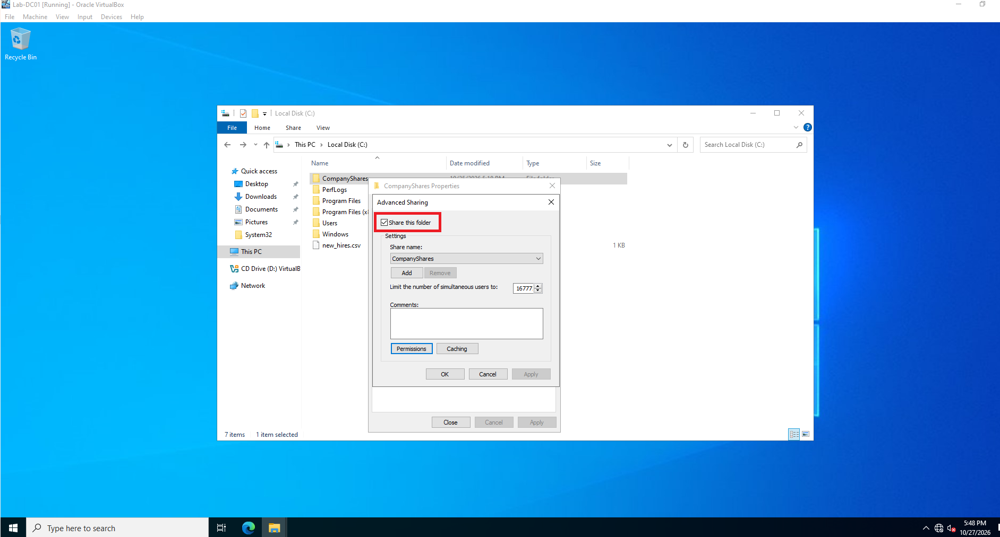
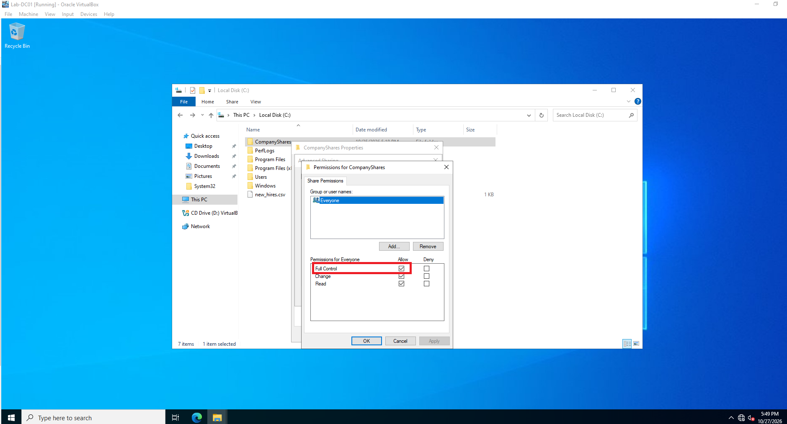
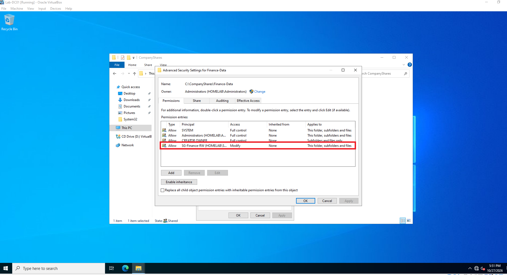

# Network File Share

Create new Folder "CompanyShares" in C:/ drive  
Create subfolder "C:/CompanyShares/Finance-Data"  
Finance-Data -> Properties -> Turn on Sharing

Check "Full Control" for "Everyone" in Advanced Sharing

Security Tab  
Select "Convert inherited permissions into explicit permissions on this object"  
Remove "Users"  
Add -> Select a Principal  
Add in "SG-Finance-RW"  

For "CompanyShares" Folder, turn on sharing and allow everyone full control
