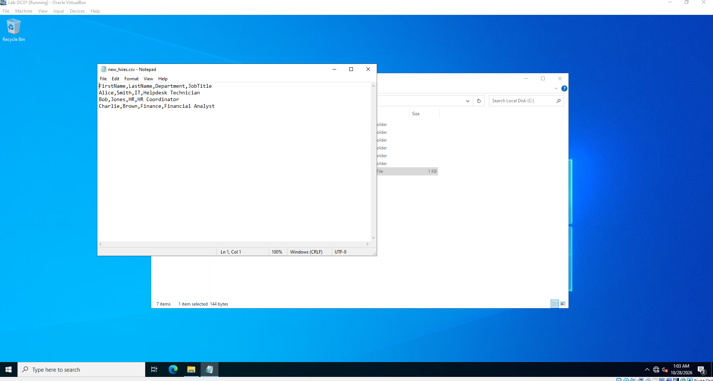
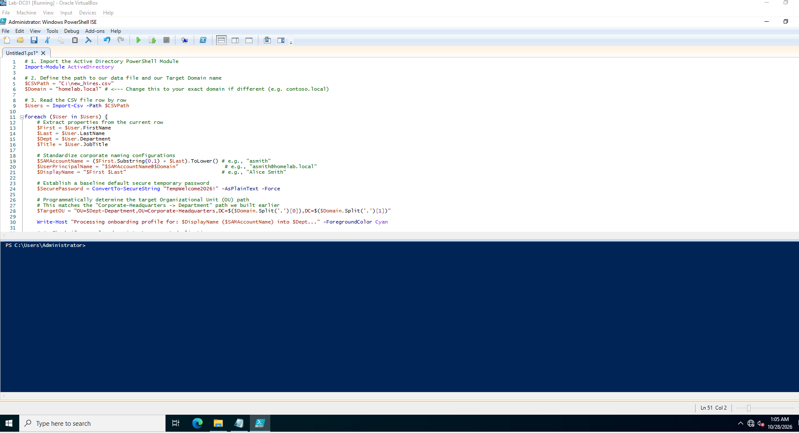
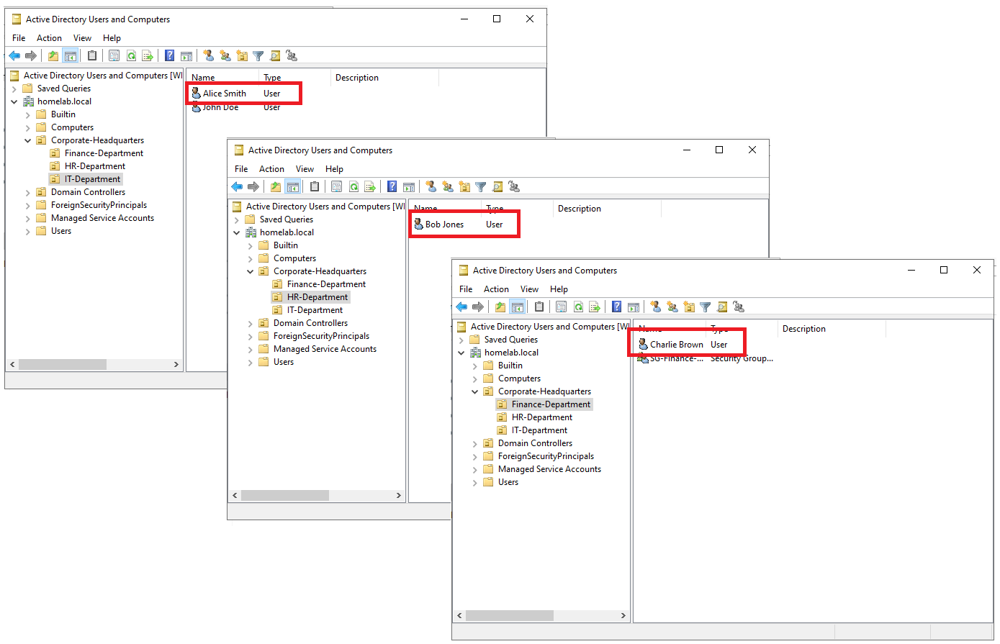

# Onboarding new hires via .csv matrix and Powershell ISE automation

Mock .csv file created containing information on employees that need to be distributed to respective OUs

Utilized the onboarding powershell code to automate and distribute data to corresponding OUs.

Confirmed the data was created by accessing the domain OUs and finding the newly added employees inside their respective groups

[← Back to Main Portfolio](index.md)
