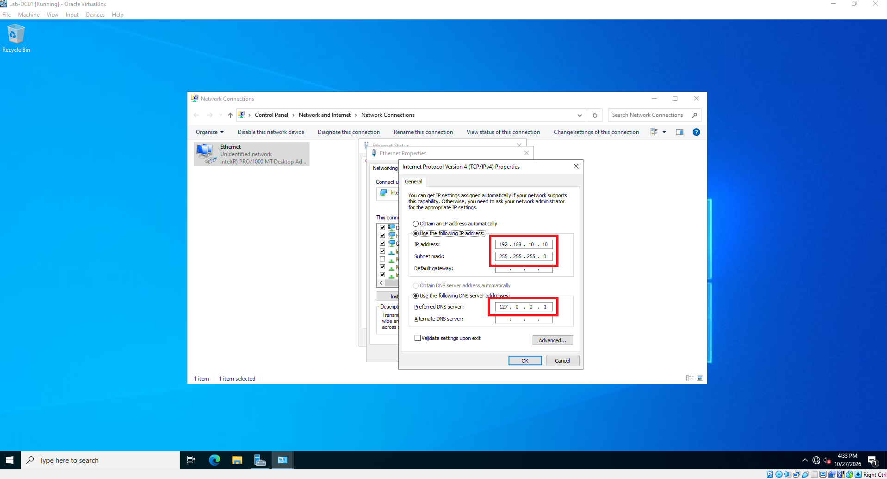

# Assigning Static IPs to Server and Client

Accessed ethernet properties
Accessed IPv4 properties
Assigned static IP address to server: 192.168.10.10
Assigned subnet mask 255.255.255.0
Assigned a loopback DNS server address: 127.0.0.1 to tell the server to look at itself for DNS lookup.

[← Back to Main Portfolio](README.md)
