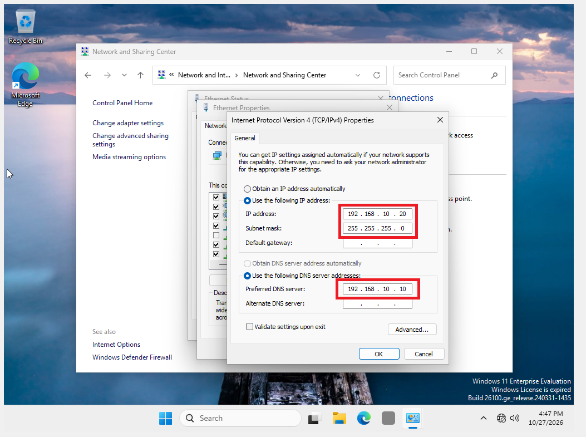
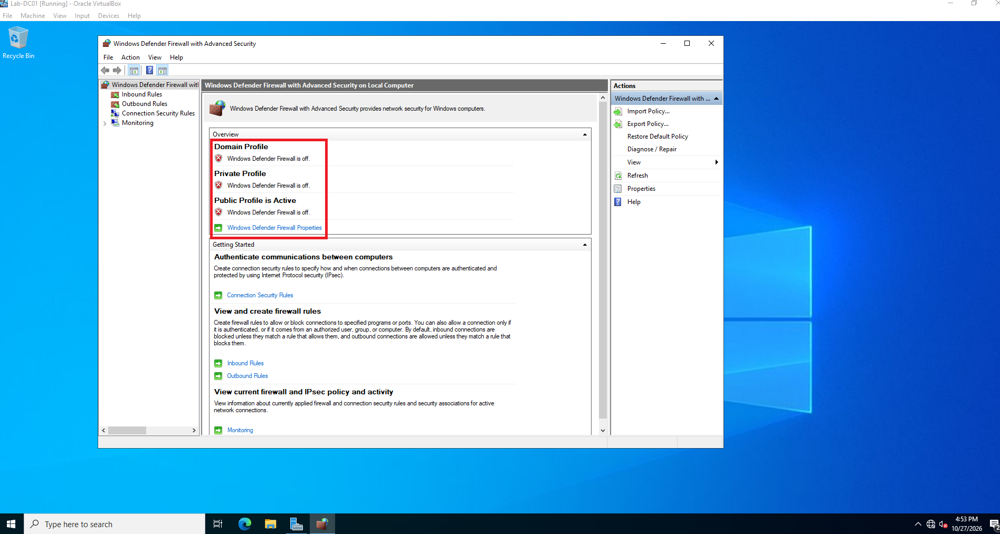
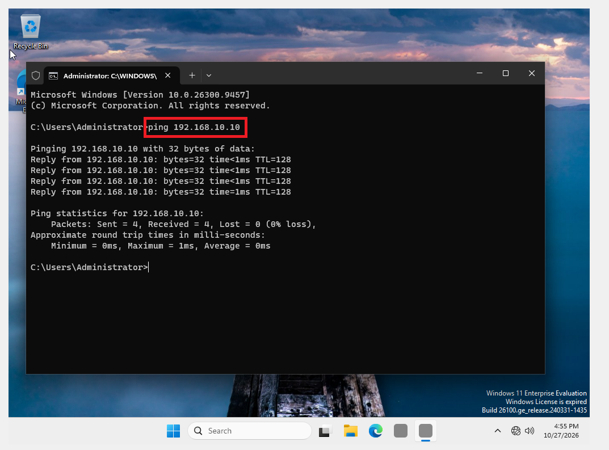
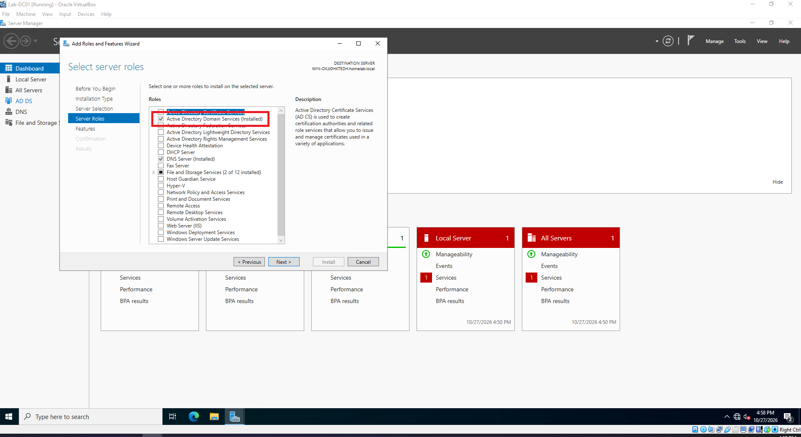
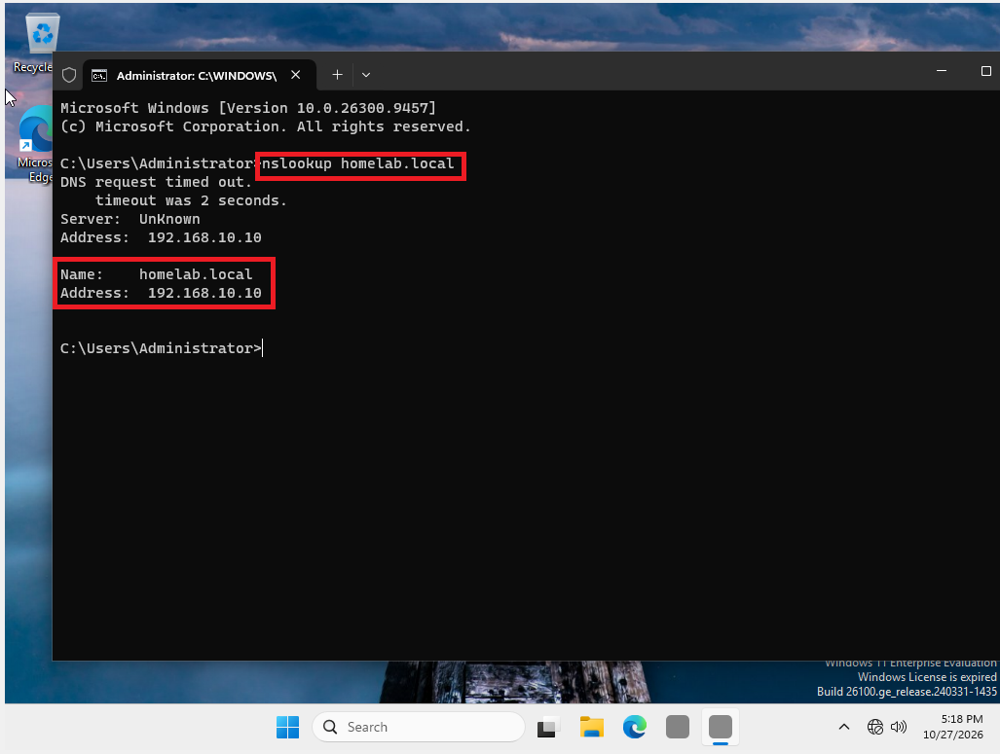
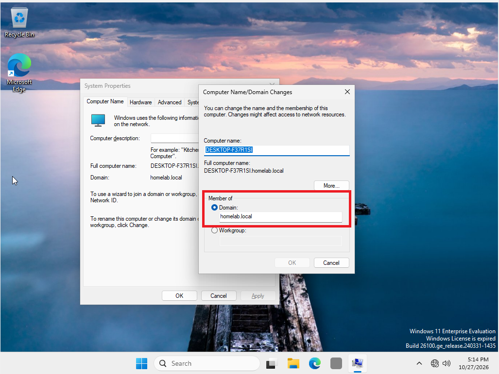
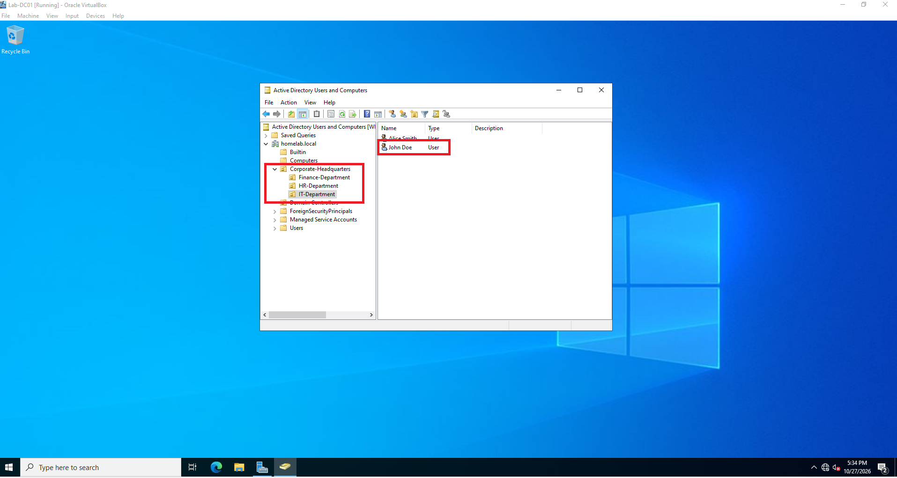
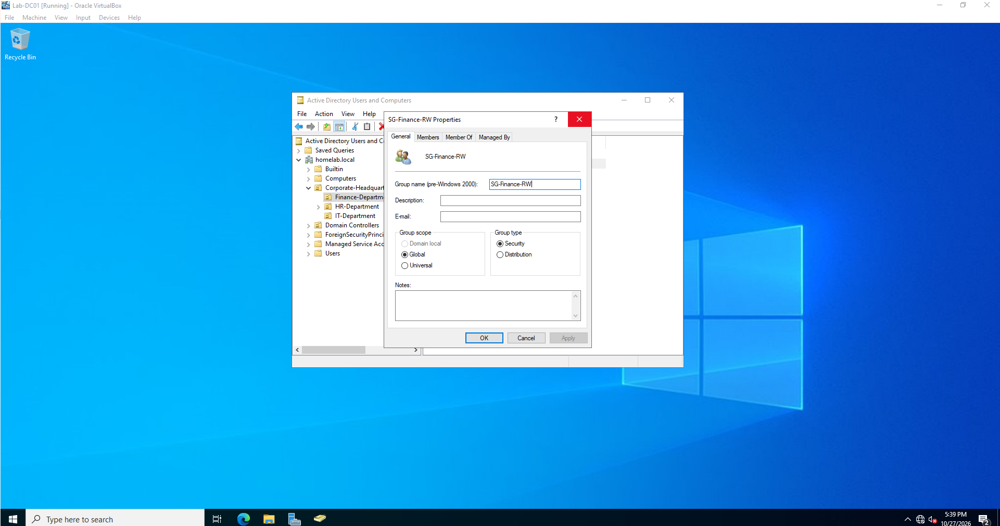
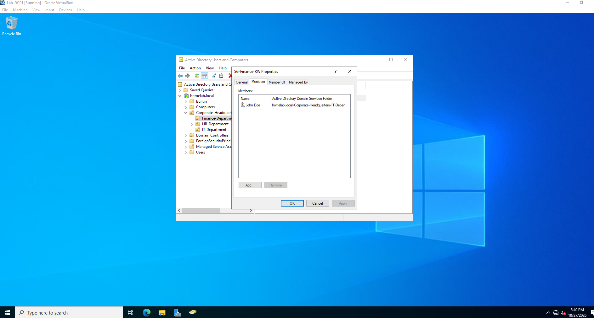

# Assigning Static IPs to Server and Client

Accessed ethernet properties.  
Accessed IPv4 properties  
Assigned static IP address to server: 192.168.10.10  
Assigned subnet mask 255.255.255.0  
Assigned a loopback DNS server address: 127.0.0.1 to tell the server to look at itself for DNS lookup.  

# Assigning Static IP to Client and connecting to DNS server

Process repeated for the Client Computer  
DNS Address Assignment: 192.168.10.10 to tell client to look to server for DNS lookup.

To test connection, the firewall was disabled.  
Risk was minimal because both computers are isolated on the same network

# Test Connection

Connection was tested by pinging the server from the client computer using server IP address  

# Installing Active Directory Domain Service (AD DS) Role

Server Manager -> Manage -> Add Roles and Features -> Active Directory Domain Services  

# Promote Server to Domain Controller

Assigned the server as the domain controller  
Assigned root name "homelab.local"  
Assigned a Directory Services Restore Mode (DSRM) password  

# Resolve server domain name to its static IP for client computer

Command "nslookup" on Client computer to make sure it resolves to the server IP

# Add Client to Domain

Accessed Client System Properties  
Selected "domain" and assigned server domain name  

# Create new Organizational Unit (OU) and assign new standard user account

Accessed Active Directory Users and Computers  
New -> Organizational Unit (OU)  
Label "Corporate-Headquarters"  
New -> Organizational Unit (OU)  
Label "IT-Department", "HR-Department", "Finance-Department"  
New -> User: "John Doe" to the group: "IT-Department"
Assigned temporary password and selected "user must change password at next logon"  

# New Security Group in Active Directory

Accessed Active Directory Users and Computers  
In the Finance-Department OU  
New -> Group  
Group Name: "SG-Finance-RW"  

Add Members: John Doe to the Security Group "SG-Finance-RW" under the Member tab  

[← Back to Main Portfolio](index.md)
